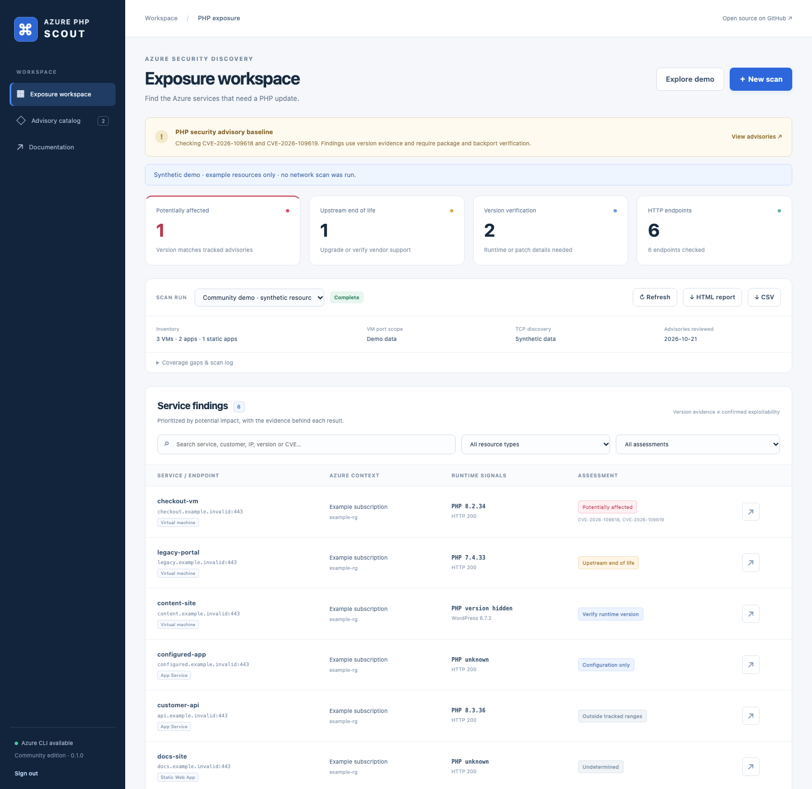

# Azure PHP Scout

Find Azure services that may need a PHP security update. Azure PHP Scout combines
read-only Azure inventory, TCP/HTTP discovery, and source-linked PHP version
assessment in a self-hosted dashboard and CLI.

[](https://github.com/saeid-adz/azure-php-scout/actions/workflows/ci.yml)
[](LICENSE)



## What it does

- Discovers VMs, App Services, deployment slots, and Static Web Apps across the
  enabled subscriptions visible to Azure CLI, including delegated subscriptions
  where access is available.
- Finds open VM ports and checks them for HTTP/HTTPS, including nonstandard ports.
  Managed applications are checked on their default/custom hostnames on 80/443.
- Identifies PHP/WordPress signatures and keeps runtime evidence separate from
  Azure configuration settings.
- Prioritizes potentially affected PHP versions, upstream end-of-life branches,
  and services whose runtime version needs verification.
- Runs scans in a persistent, cancellable queue with live coverage, history,
  isolated artifacts, and offline HTML/CSV/JSON exports.
- Optionally inspects PHP inside all VMs in one selected subscription or specific Windows/Linux VMs, including
  private VMs, using fixed Azure Run Command scripts.

The bundled catalog was reviewed on **21 October 2026** and tracks
**CVE-2026-109618** and **CVE-2026-109619**. It is deliberately scoped to those two
PHP core advisories; it is not a complete vulnerability database. A version match
is a triage finding. Verify the serving runtime, deployment conditions, package
build, and vendor backports before deciding a service's actual patch status.

## Quick start

Requirements: Python 3.11+; Azure CLI and its Resource Graph extension for live
Azure inventory. CSV/manual scans and the synthetic demo work without Azure CLI.

```sh
git clone https://github.com/saeid-adz/azure-php-scout.git
cd azure-php-scout
python3 -m venv .venv
. .venv/bin/activate
pip install .
azure-php-scout serve
```

On Windows, activate with `.venv\Scripts\Activate.ps1`.

Open **http://127.0.0.1:8000**, then obtain the service token in another terminal:

```sh
azure-php-scout token
```

Paste it into the sign-in form. The browser keeps it for the lifetime of its tab.
Use **Explore demo** to see synthetic findings without making network requests,
or **New scan** to choose Azure, individual targets, or an inventory CSV.

The service defaults to a local listener and stores its token, SQLite history,
and run artifacts in `.scout/`. `--data-dir` or `SCOUT_DATA_DIR` changes that folder.
Use the same directory for `serve` and `token`. Keep it private and backed up.

## Connect Azure

On the service host:

```sh
az login
az extension add --name resource-graph
```

The identity needs permission to read the selected resources, typically the
Reader role on the subscriptions being scanned. Resource Graph queries are
explicitly scoped, grouped by tenant, and paginated. The UI can list available
subscription IDs; leaving that selection empty includes all enabled subscriptions
visible to the CLI session.

Azure CLI credentials stay on the operator's host. The application does not ask
for Azure passwords in the browser. For a self-hosted worker in Azure with an
assigned managed identity, authenticate its CLI session with `az login --identity`
before scanning. See [deployment guidance](docs/DEPLOYMENT.md).

## CLI workflows

Discover Azure resources and scan common web ports:

```sh
azure-php-scout scan --azure -o results.csv
```

Scan the complete VM TCP range, then fingerprint open services:

```sh
azure-php-scout scan --azure --vm-ports all -o full-scan.csv
```

Full range means **1–65535 TCP ports per public VM address** and can take hours.
The default common profile contains 127 candidate ports. Both the terminal and
report show the selected scope; the common profile never claims full coverage.
App Service and Static Web App addresses are not subjected to fleet port sweeps.

```sh
# Restrict Azure scope; repeat --subscription for more IDs.
azure-php-scout scan --azure --subscription SUBSCRIPTION-ID --running-only

# A custom VM discovery range.
azure-php-scout scan --azure --vm-ports 80,443,3000-3010,8000-9000

# A named website pinned to an IP, with explicit port checks.
azure-php-scout scan --ip 203.0.113.10 --host www.example.com --ports 80,443,8080,8443

# Import inventory; no Azure API access is required.
azure-php-scout scan -i inventory.csv --vm-ports web

# Validate scope without making endpoint connections.
azure-php-scout scan --azure --dry-run

# Re-assess existing scanner results offline.
azure-php-scout assess results.csv -o reviewed.csv

# Convert saved scanner results and adjacent coverage JSON to HTML.
azure-php-scout scan --report-from results.csv
```

`--dry-run --azure` still performs read-only Azure inventory, while omitting output
files and endpoint connections. CLI scans save their inventory beside the run's
working directory; each service run uses its own directory. No local inventory is
implicitly loaded into a new scan.

CSV inventories need `publicIp`, `ip`, or `hostname`. Optional fields such as
`subscription`, `vm`, `app`, `resourceGroup`, and `resourceType` preserve ownership.
A row containing both IP and hostname uses that IP with the hostname for HTTP Host
and TLS SNI. See [examples/inventory.csv](examples/inventory.csv). Explicit targets
and `-i` inputs can be repeated.

Control work with `--workers`, `--timeout`, `--port-workers`, `--port-rate`, and
`--port-timeout`. Pending HTTP work and TCP sockets are bounded. Redirects stay on
the original connect address; new DNS hostnames change Host/SNI. Redirects to a
different literal IP or an unselected port are recorded instead of followed.

## Inspect PHP inside Windows and Linux VMs

In **New scan**, select **VM guest inspection (Windows / Linux)**, then **All VMs
in one subscription**. Load available subscriptions and choose one, or paste its
subscription ID. No individual VM IDs are needed. All discovered VMs are included,
with or without public IPs, with no 50-VM limit. The combined HTML report includes
findings and skipped/failed VMs. You can preview the VM inventory and review both
bundled scripts before starting.

For a smaller scope, choose **Selected VM resource IDs** and browse or paste up to
50 IDs. Normal external scans never submit guest commands automatically.

```sh
# Discover all VMs in one subscription and preview the command plan.
azure-php-scout guest --subscription SUBSCRIPTION-ID --dry-run

# Inspect the subscription and create subscription-php.html, .csv and .coverage.json.
azure-php-scout guest --subscription SUBSCRIPTION-ID -o subscription-php.csv

# Preview a selected VM without submitting a guest command.
azure-php-scout guest --vm-id /subscriptions/SUBSCRIPTION-ID/resourceGroups/MY-RG/providers/Microsoft.Compute/virtualMachines/MY-VM --dry-run

# Inspect a selected VM; repeat --vm-id to include Windows and Linux VMs together.
azure-php-scout guest --vm-id /subscriptions/SUBSCRIPTION-ID/resourceGroups/MY-RG/providers/Microsoft.Compute/virtualMachines/MY-VM -o guest-results.csv
```

This is a separate, opt-in execution mode. Azure Run Command executes the fixed
inspection scripts as **root on Linux / SYSTEM on Windows**. The scripts do not
install packages or change application configuration; Azure still creates Run
Command agent/extension artifacts and logs. The identity needs Run Command
permission in addition to read access; **Reader alone is insufficient**.

Linux inspection checks common PHP/FPM/CGI binary paths, Debian/RPM core packages,
and PHP process presence. Windows checks common PHP locations, running PHP process
paths, and IIS FastCGI mappings, reading executable version metadata without
executing `php.exe`. Guest evidence is labeled separately from HTTP evidence.
Installed package/file versions do not prove which runtime is executing web
requests, and vendor backports require verification.

Private VMs need a running, ready Azure VM Agent and its outbound connectivity;
they do not need a public IP, SSH, or RDP. VMs are inspected sequentially. Stopping
a run prevents further submissions and stops waiting, but **cannot cancel a guest
script already submitted to Azure**. Timeouts and incomplete output remain visible.
See [guest inspection and permissions](docs/GUEST-INSPECTION.md) for limits,
supported locations, and the exact authorization required.

## Docker

The image includes Azure CLI and Resource Graph, runs as a non-root user, and uses
`/data` for persistent state. Generate an API token and start the local Compose
service:

```sh
python3 -c "import secrets; print('SCOUT_API_TOKEN=' + secrets.token_urlsafe(32))" > .env
docker compose up --build -d
```

Open http://127.0.0.1:8000 and sign in with the token from `.env`. To authenticate
Azure CLI inside the container:

```sh
docker compose exec scout az login --use-device-code
```

Use `az login --identity` in an Azure environment configured for managed identity.
The named volume persists CLI state and scan history. `docker compose down` stops
the service; deleting the volume also deletes its saved data.

For remote hosting, set a random `SCOUT_API_TOKEN`, set `SCOUT_ALLOWED_HOSTS` to the
service hostname, and place the service behind TLS and a restricted ingress. The
built-in token is a single-operator credential. This release is not a multi-tenant
SaaS platform. Run **one service worker per data directory**.

## Understanding findings

| Assessment | Meaning | Action |
| --- | --- | --- |
| Potentially affected | Observed upstream version matches a tracked CVE range. | Verify package/backports and update the serving runtime. |
| Upstream end of life | Branch is outside recorded upstream security support. | Upgrade or verify an appropriate vendor support arrangement. |
| Verify runtime version | PHP/WordPress evidence lacks a complete, unambiguous runtime version, or branch coverage is unavailable. | Confirm the runtime serving traffic and its build. |
| Configuration only | Azure exposes PHP configuration without runtime version evidence. | Check whether the setting is used by the deployed app. |
| Outside tracked ranges | Observed version does not match this catalog's ranges. | Continue checking vendor advisories; this is not a clean bill of health. |
| Undetermined | Evidence is insufficient to assess a PHP runtime. | Investigate as needed; absence of a signature does not prove absence of PHP. |

The reviewed upstream fixed releases for both bundled CVEs are **8.2.35**,
**8.3.36**, **8.4.27**, and **8.5.12**. Version comparisons are branch-specific;
prereleases do not count as the stable fixed release. Distribution and LTS vendors
may ship backported fixes under older upstream version numbers. Older branches
are flagged for support/vendor verification rather than asserting identical
exploitability for every historical PHP release.

Updating an application or WordPress does not establish that its underlying PHP
runtime is patched. Apply the appropriate PHP package/image/platform update,
restart or redeploy serving workers, and verify the runtime handling web requests.
The app provides guidance and official links; it does not run remediation commands.

Sources: [PHP security announcement](https://www.php.net/archive/2026.php#2026-10-21-5),
[OOM corruption advisory](https://github.com/php/php-src/security/advisories/GHSA-w8hw-w9fx-j79w),
[stale global state advisory](https://github.com/php/php-src/security/advisories/GHSA-6wmf-4rv5-p3rp),
[PHP support lifecycle](https://www.php.net/supported-versions.php).

## Coverage and limits

- This is an external scan of directly attached VM public IPs and managed app
  hostnames. Private/NAT-only VMs appear as skipped. Supply a reachable target and
  run from an appropriate network to assess internal services.
- Azure access failures, expired tenant sessions, skipped resources, TCP timeouts,
  and selected ranges remain visible. A timeout is not proof a port is closed.
- Name-based virtual hosts and hidden runtime headers limit fingerprinting. Known
  hostnames improve coverage. Static exports/CDNs can retain WordPress markers.
- WordPress implies possible PHP use, while configured PHP values remain separate.
  The scanner does not derive PHP versions from WordPress or plugin asset versions.
- Static Web App default/custom production hostnames and App Service slots are
  included when returned by Resource Graph. Static preview environments are not
  separately enumerated. DNS/ingress can route outside the Azure resource itself.
- The probe uses HTTP GETs for `/` and limited WordPress discovery paths. It does
  not send exploit payloads, crawl arbitrary pages, or request PHP diagnostics.
- TLS certificate checks default off for bare IP/self-signed endpoints; use
  `--verify-tls` when trusted certificate matching is required. The scan does not
  assess TLS security. Response and decompression limits are 300 KB.
- Assessment reflects the bundled reviewed catalog, not a continuously updated
  vulnerability feed. See [advisory maintenance](docs/ADVISORIES.md).

## Development and community

```sh
pip install -e '.[dev]'
python -m pytest -q
python -m build
```

Tests use synthetic Azure records and local TCP/HTTP/HTTPS fixtures. CI also builds
the container. Neither automatically scans a developer's Azure estate. Review
[CONTRIBUTING.md](CONTRIBUTING.md), [SECURITY.md](SECURITY.md),
[API documentation](docs/API.md), and [architecture](docs/ARCHITECTURE.md).

Please keep real inventories, report files, credentials, and tenant identifiers
out of issues and pull requests. The repository contains only synthetic examples.
Licensed under [MIT](LICENSE).
