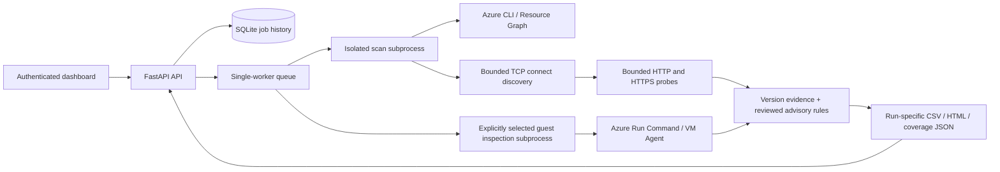

# Architecture

`inventory.py` normalizes metadata and preserves discovery errors.
`discovery.py` uses a selector with bounded sockets and rate control; it does not
allocate a future per port. `scanner.py` feeds a bounded HTTP queue from open TCP
connections. Managed hostnames are checked directly on HTTP/HTTPS ports.

`guest.py` implements a separate opt-in workflow on explicit VM IDs or all VMs in
one selected subscription, or every subscription available to the host account.
Account mode refreshes the subscription list, deduplicates accounts, groups by
tenant in batches of 100, and retries failed inventory batches per subscription.
It records subscription coverage and continues successful scopes after discovery
or Run Command failures elsewhere. Non-enabled subscriptions remain as skipped.
Single-subscription mode first resolves a paginated Resource
Graph inventory, including private and stopped VMs, and rejects incomplete discovery
before executing commands. Each job keeps one combined report and a coverage
snapshot, including skipped, failed, and cancelled/unsubmitted resources. It checks
power/agent readiness, then submits a fixed packaged Linux/Windows script using
the target subscription. Results use a bounded framed output protocol, preserve
per-VM failures and remote cancellation uncertainty, and label package/disk
versions separately from HTTP evidence. Reader-only inventory does not execute
these scripts. No custom guest script is accepted by the API.

`advisories.py` separates observed runtime versions, configuration values, missing
versions, upstream lifecycle, and branch-specific CVE ranges. `report.py` renders
escaped standalone HTML. `service.py` validates requests and protects APIs;
`jobs.py` persists history, owns a process lock, and manages isolated child workers.

Each run's directory contains its input (if imported), scanner log, results,
coverage JSON, and any Azure inventory cache. Credentials remain in the operator's
Azure CLI configuration. The service token is removed from child worker environment.
A private local data directory is the supported storage topology; network-shared
SQLite and multiple service workers are not supported.

Graceful service shutdown cancels pending jobs and stops active children. After a
hard process/container kill, scan history is marked interrupted on restart. An
external process supervisor/container runtime should terminate the full process
group during a hard stop. This first release has no distributed worker system,
automatic cloud remediation, multi-user authorization, or scheduled scans.
