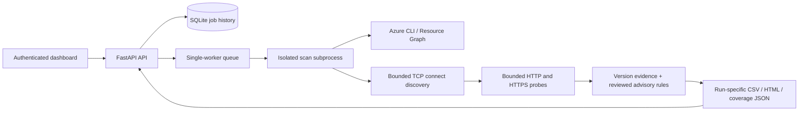

# Architecture

`inventory.py` normalizes metadata and preserves discovery errors.
`discovery.py` uses a selector with bounded sockets and rate control; it does not
allocate a future per port. `scanner.py` feeds a bounded HTTP queue from open TCP
connections. Managed hostnames are checked directly on HTTP/HTTPS ports.

`advisories.py` separates observed runtime versions, configuration values, missing
versions, upstream lifecycle, and branch-specific CVE ranges. `report.py` renders
escaped standalone HTML. `service.py` validates requests and protects APIs;
`jobs.py` persists history, owns a process lock, and manages isolated child workers.

Each run's directory contains its input (if imported), scanner log, results,
coverage JSON, and any Azure inventory cache. Credentials remain in the operator's
Azure CLI configuration. The service token is removed from child worker environment.
A private local data directory is the supported storage topology; network-shared
SQLite and multiple service workers are not supported.

Graceful service shutdown cancels pending jobs and stops active children. After a
hard process/container kill, scan history is marked interrupted on restart. An
external process supervisor/container runtime should terminate the full process
group during a hard stop. This first release has no distributed worker system,
automatic cloud remediation, multi-user authorization, or scheduled scans.
