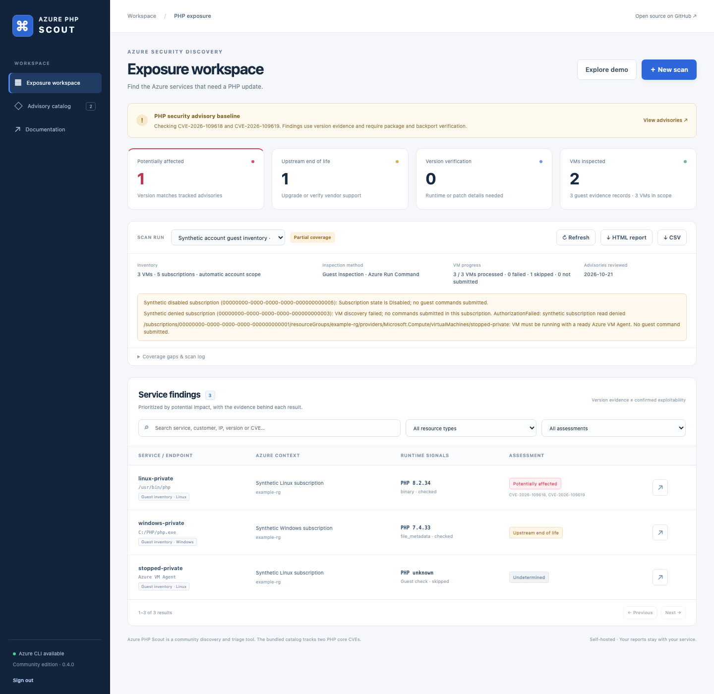
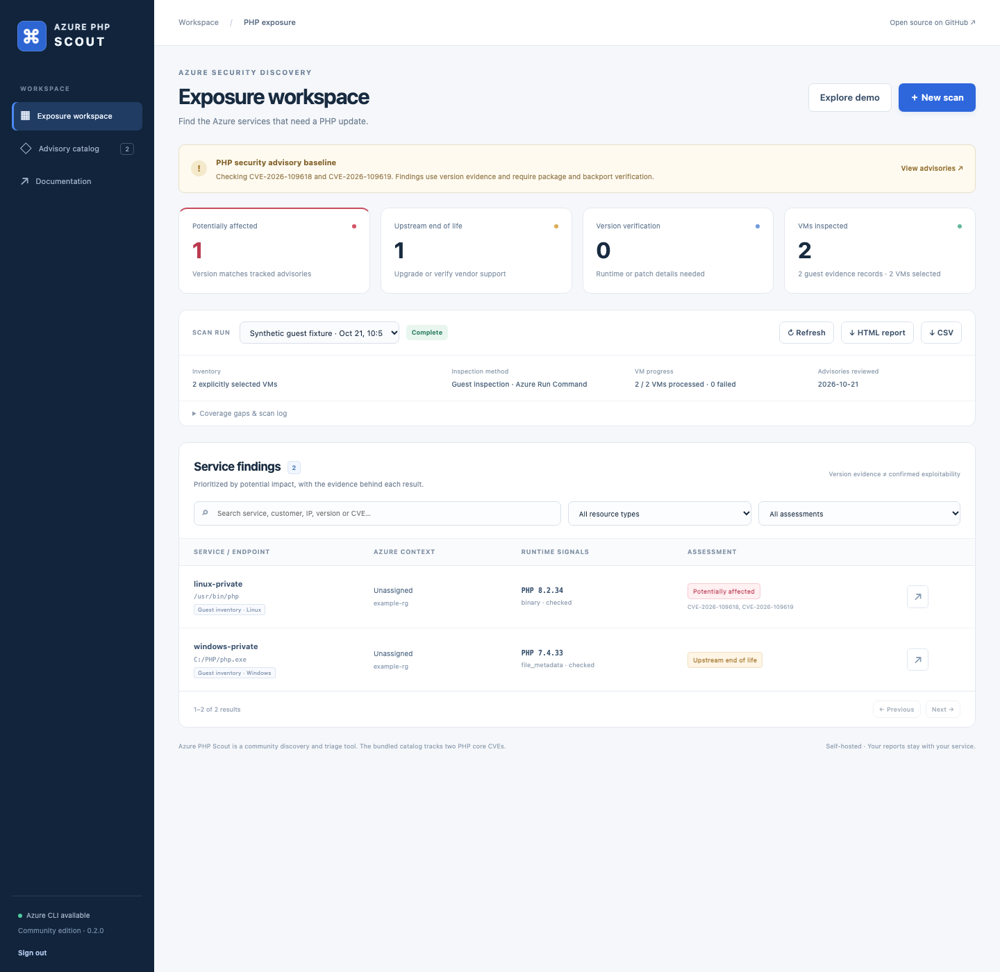

# VM guest inspection

Guest inspection uses Azure **Action Run Command** (`az vm run-command invoke`)
on all VMs across **all accessible subscriptions**, one selected subscription, or
an explicit list of at most 50 VM resource IDs. It works with Windows and Linux
VMs, including private VMs. Subscription scopes have no 50-VM limit. Account-wide
execution is explicitly selected; an empty scope never starts guest commands.
It includes regular `/virtualMachines/` resources; VM scale-set child-instance
resource IDs are not enumerated or accepted. Normal Azure/HTTP scans never
implicitly submit guest commands.

## Automatically inspect all accessible subscriptions

Choose **VM guest inspection → All accessible subscriptions (automatic)** in the
dashboard and start the inspection. Subscription IDs, VM IDs, and a preview are
not required. The CLI equivalent is:

```sh
azure-php-scout guest --all-subscriptions --dry-run
azure-php-scout guest --all-subscriptions -o account-php.csv
```

The worker calls `az account list --all --refresh` to discover current subscription
access from the host's signed-in Azure CLI session. Enabled subscriptions are
grouped by tenant and queried in batches of at most 100, with all VM continuation
pages. There is no 1,000-subscription truncation. Duplicate account records are
deduplicated. Disabled/non-enabled subscriptions remain in coverage as skipped.
The scanner does not sign into additional accounts or grant Azure permissions.

If a batch fails, inventory reads are retried per subscription to isolate failures.
A subscription with incomplete, truncated, or denied inventory receives no guest
commands; other successfully discovered subscriptions continue automatically.
Guest commands themselves are never automatically retried. Run Command permission
failures and unavailable agents are recorded per VM and do not abort the remaining
VMs. The entire discovered fleet is processed sequentially and may take hours.

One HTML/CSV/coverage JSON report contains all discovered VMs. The HTML includes
a subscription table with names, IDs, tenants, discovery status, and VM counters,
including empty, skipped, inaccessible, and cancelled subscriptions. A partial
scan is not presented as complete coverage. Account refresh failure stops the run
without submitting commands and still produces an explanatory report.

The account needs read access to each subscription for full VM inventory and Run
Command action permission on the VMs being inspected. Subscription visibility
alone does not guarantee either permission. The accessible scope is the refreshed
CLI session; tenants/accounts that require another login cannot be scanned until
that authentication is available on the host.

See Microsoft's [account list documentation](https://learn.microsoft.com/en-us/cli/azure/account#az-account-list)
and [Resource Graph subscription-limit guidance](https://learn.microsoft.com/en-us/azure/governance/resource-graph/troubleshoot/general#scenario-too-many-subscriptions).



This screenshot uses synthetic subscriptions and mocked Azure responses.

## Inspect one subscription or selected VMs

In the dashboard choose **VM guest inspection → All VMs in one subscription**,
load the subscriptions and choose one ID. Previewing the inventory is optional;
the worker discovers a fresh inventory when the job starts. The CLI equivalent is:

```sh
azure-php-scout guest --subscription SUBSCRIPTION-ID --dry-run
azure-php-scout guest --subscription SUBSCRIPTION-ID -o subscription-php.csv
```

Discovery uses Azure Resource Graph with an explicit subscription scope and all
continuation pages, without a public-IP filter. It completes before any guest
command is submitted. Incomplete, truncated, or failed discovery prevents execution
and produces an HTML/CSV/coverage report explaining the failure. An empty
subscription produces an empty report. The inventory is a snapshot of resources
visible to the host identity; grant Reader over the subscription for full coverage.
Resources created after discovery are picked up by a later scan.

All discovered VMs stay in the combined report, including stopped/unready VMs,
permission failures, and VMs not submitted after cancellation. The report records
the subscription ID/name, discovery status, and requested, checked, failed,
skipped, and not-submitted counts. VMs are never started automatically.

**Selected VM resource IDs** retains the existing 1–50 ID workflow. Its optional
subscription filters affect browsing only. `--all-subscriptions`, `--subscription`, and `--vm-id` are
mutually exclusive execution scopes.



The screenshot uses mocked Azure responses and synthetic VM resources.

## What executes

- Linux: [`inspect-linux.sh`](../src/azure_php_scout/scripts/inspect-linux.sh),
  through `RunShellScript`, as root. It checks common PHP/FPM/CGI paths with
  `timeout 3 ... -n -v`, skipping php.ini, then reads Debian/RPM core package
  versions and PHP process names. Binary probes drop to the non-root `nobody`
  account with cleared supplementary groups and `no-new-privs`; installed PHP
  binaries are never executed as root. Probes are skipped if `timeout`, `setpriv`,
  or a suitable non-root account is unavailable. No application code or diagnostic
  PHP page is run.
- Windows: [`inspect-windows.ps1`](../src/azure_php_scout/scripts/inspect-windows.ps1),
  through `RunPowerShellScript`, as SYSTEM. It reads PHP executable version
  metadata from common paths, running process executable paths, and IIS FastCGI
  mappings. It does not execute PHP binaries or print application configuration.
  UNC paths are skipped; PATH browsing is restricted to local drive paths.
  Four-part file versions retain their fourth component as a `+file.N` build
  suffix while comparing the PHP major/minor/patch numbers.

The API accepts no custom script, command ID, or script parameter. Operators can
review the exact scripts through the authenticated UI/API. Every successful
inventory row records the script SHA-256. Azure credentials stay in the host CLI;
the service token is removed from the Azure CLI worker environment.
The worker submits a private snapshot of the bundled script and records that
snapshot's hash, so editing/updating the source during an inspection does not
change the recorded identity of an already submitted script.

The scripts do not install software, update PHP, alter IIS/configuration, restart
services, or read WordPress configuration/passwords. Run Command itself executes
privileged code and creates its normal extension/agent artifacts and logs. Protect
the service token accordingly: it can request these guest checks using the host
identity's Azure permissions.

## Permissions and prerequisites

The host Azure CLI identity needs resource read access for VM browsing and these
operations on the selected VMs:

| Permission | Purpose |
| --- | --- |
| `Microsoft.Compute/virtualMachines/read` | Read the guest operating system. |
| `Microsoft.Compute/virtualMachines/instanceView/read` | Verify VM power and agent readiness. |
| `Microsoft.Compute/virtualMachines/runCommand/action` | Invoke Action Run Command. |
| `Microsoft.Compute/locations/runCommands/read` | Read command definitions; provided by Reader at subscription scope. |

Use Reader for inventory and a custom role granting `runCommand/action` on the
VMs to be inspected (or the selected subscription for fleet inspection).
Virtual Machine Contributor also permits invocation
but grants broader capabilities. The service does not assign roles automatically.
The action endpoint used here is `/virtualMachines/{name}/runCommand`; this is
separate from managed Run Command child resources and their `runCommands/write`
permission.

Each VM must be running with a ready Azure VM Agent. The worker verifies both
before submitting the command. The agent needs outbound access to Azure endpoints
on port 443 to return results. No inbound SSH/RDP or directly attached public IP
is required. Stopped, unsupported, or unready VMs are recorded as skipped.

See Microsoft's [Linux Run Command](https://learn.microsoft.com/en-us/azure/virtual-machines/linux/run-command),
[Windows Run Command](https://learn.microsoft.com/en-us/azure/virtual-machines/windows/run-command),
[CLI invoke](https://learn.microsoft.com/en-us/cli/azure/vm/run-command#az-vm-run-command-invoke),
and [Action Run Command REST API](https://learn.microsoft.com/en-us/rest/api/compute/virtual-machines/run-command)
documentation. Both platforms use the fixed command ID appropriate to their OS.

## Findings and coverage

Guest rows use `evidenceSource=guest` and have no HTTP URL or port. The source,
binary path or package, full vendor package version, process-presence signal,
inspection status, and script hash appear in the evidence details and CSV export.
Different PHP versions/installations are assessed independently. HTTP response
counts remain zero for a guest-only scan. The dashboard/report instead shows VMs
inspected and software evidence records.

Package/file versions are disk inventory, not proof of the runtime loaded in a
web worker. A process-presence signal does not map every installed version to an
active web service. Updates can leave older workers loaded until restarted.
Distribution/LTS packages can backport fixes under older upstream numbers. The
existing version-based advisory and lifecycle uncertainty remains applicable.

These checks are bounded, not an exhaustive filesystem or software inventory:

- Linux: `/usr/sbin/php-fpm*`, `/usr/bin/php-cgi*`, `/usr/bin/php*`,
  `/usr/local/bin/php`, `/usr/local/sbin/php-fpm`, common Remi/Plesk installations,
  and `/usr/local/php*/bin/php`. Up to 8 binary candidates are checked and 16 core
  package records considered. Binary probes require `timeout`, `setpriv`, and a
  non-root `nobody` account, and must be readable/executable by that account.
- Windows: PATH, PHP process paths, IIS FastCGI application mappings,
  `C:\PHP*`, `C:\xampp\php`, `C:\wamp[64]\bin\php\php*`, and PHP under Program
  Files. Up to 8 file candidates are inspected. Windows checks file metadata,
  not the registry or the package manager.
- Custom/container installations, Apache module-only installations, deleted or
  replaced binaries loaded in memory, and WordPress/plugin inventories are not
  exhaustively inspected. A missing version remains **unknown**, never proof
  that PHP is absent or the machine is unaffected.

Azure returns only the last 4,096 output bytes. Scripts use a compact framed
protocol and an approximately 3,200-byte evidence budget. Base64 fields prevent
paths/package data from breaking the record format. Missing frames, OS mismatch,
malformed output, version-read failures, and output/candidate limits are reported
as failed or incomplete checks instead of a successful absence finding.

## Cancellation, timeouts, and retries

Select a finished guest scan in the dashboard and use **Retry remaining VMs** to
create a new run from its saved CSV. This includes `failed`, `timeout`, `cancelled`,
and `not_submitted` VMs, deduplicated by resource ID. VMs with any checked,
incomplete-but-inspected, or skipped row are excluded. The source report is kept
unchanged; the new report contains only this retry's results and identifies the
source scan. There is no 50-VM limit for retries. No subscription rediscovery is
needed, so the original VM scope cannot expand to newly created resources.

```sh
az login
azure-php-scout guest --retry-from previous-results.csv --dry-run
azure-php-scout guest --retry-from previous-results.csv -o retried-results.csv
```

Retry dry-run reads the local report and makes no Azure requests. CLI output must
differ from the source filename. Retry includes only VMs recorded in the saved
report; resources missing because subscription discovery failed are outside that
retry and need a new inventory scan. Repeated retries can use the latest retry
report to target only what still failed. Skipped/offline VMs need a separate
selection when they are ready to be inspected.

When an Azure request returns an expired-sign-in / AADSTS / interactive-login
error, the worker stops further VM submissions and records those VMs as
`not_submitted`. The coverage field `guest.authenticationRequired` is true.
Run `az login` on the service host (and sign into the required tenant when needed),
then retry the remaining VMs. The worker does not bypass sign-in-frequency or MFA
policies. Authorization/RBAC failures remain per-VM errors and do not trigger
this sign-in stop. Refreshing sign-in does not grant missing permissions.
See Microsoft's [Azure CLI sign-in documentation](https://learn.microsoft.com/en-us/cli/azure/authenticate-azure-cli-interactively).

For a timeout/cancellation, check Azure before retrying because an accepted
Action Run Command cannot be cancelled locally. Retrying a report is an explicit
operator action; guest commands are never automatically resubmitted.

VMs are checked sequentially, one request per selected VM, without automatic
retries. Azure permits one Action Run Command per VM at a time and typically
takes at least 20 seconds per invocation. Another command already in progress,
missing permission, network errors, and agent failures are preserved per VM.

`--guest-timeout` (default 180, range 60–1800 seconds) bounds how long the client
waits for the action result. Metadata/preflight CLI requests have their separate
180-second request timeout. This is not a remote execution timeout. Cancelling prevents further
submissions and stops the local wait; it cannot cancel an Action Run Command
already accepted by Azure. The report records `remoteMayContinue` when execution
state is uncertain. Check Azure before retrying such a VM. Scripts are designed
for inspection, but Azure's own Action Run Command limit can be up to 90 minutes.

`guest --dry-run` reads selected VM metadata and prints the OS/command plan. It
does not submit Run Command or create reports. Automated tests use mocked Azure
responses and local/container fixtures; live guest execution requires an operator
to choose the subscription or actual VM IDs and start that mode.
